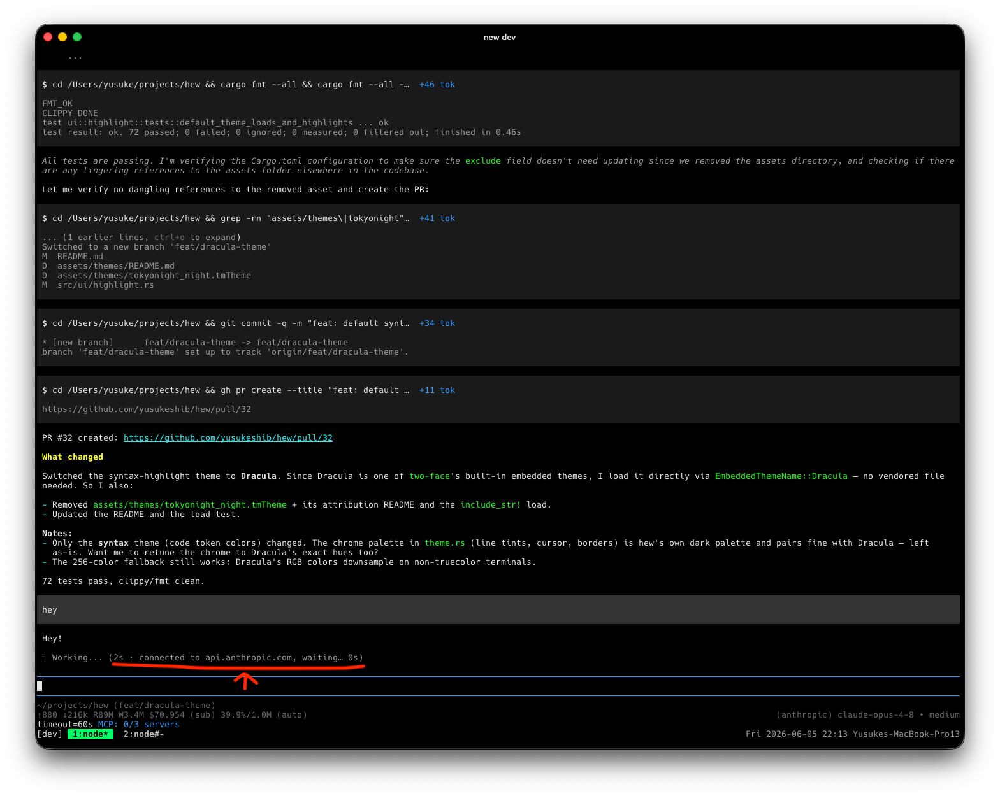

# @yusukeshib/pi-working-status

A [pi](https://pi.dev) extension that replaces the plain `Working...` loader
with a live, detailed status line tracking the agent through every phase of a
turn — request, streaming, and tool execution.

## What it looks like



The detail in parentheses changes as the turn progresses:

```text
Working... (0:02 · sending request to api.anthropic.com…)
Working... (0:04 · receiving reasoning stream… 240 tok · 1.2 KB)
Working... (0:07 · receiving text stream… 1.1k tok · 180 tok/s · 4.8 KB)
Working... (0:08 · ⚙ bash: npm test -- --watch=false)
Working... (0:09 · ⚙ running bash, read)
```

A fixed elapsed clock follows `Working`, and a detail segment shows the most
specific current activity:

| Detail                                | Meaning                                            |
| ------------------------------------- | -------------------------------------------------- |
| `⚙ <tool>: <args>`                    | single tool executing (command / path / pattern)   |
| `⚙ running <tools>`                   | multiple tools executing (deduped names, max 3)    |
| `sending request to <host>…`          | request being sent (first ~0.4s)                   |
| `waiting for response… <n>s`          | request sent, awaiting any response                |
| `receiving reasoning stream…`         | provider streaming a reasoning block               |
| `receiving text stream…`              | provider streaming assistant text                  |
| `receiving tool call…`                | provider streaming a tool call                     |
| `connected to <host>, waiting… <n>s`  | headers received, awaiting first token             |
| `HTTP <status>`                       | last response returned a non-2xx status            |

Streaming lines append token counts, `tok/s`, and decoded byte counts when the
provider reports them mid-stream (Anthropic, Bedrock, Mistral, Google). Model
id and context-window usage are intentionally omitted — pi's footer already
shows them.

## Install

```bash
pi install npm:@yusukeshib/pi-working-status
```

Via git (no npm publish required):

```bash
pi install git:github.com/yusukeshib/pi-working-status
```

Try it without installing:

```bash
pi -e npm:@yusukeshib/pi-working-status
```

## Command

### `/working-status [on|off]`

- `/working-status off` — restore pi's default `Working...` message
- `/working-status on` — re-enable the detailed status line
- `/working-status` — show the current on/off state

## How it works

The extension subscribes to pi's turn lifecycle events
(`before_provider_request`, `after_provider_response`, `message_update`,
`tool_execution_start`/`end`) and a 1s ticker, then composes the status line
through `ctx.ui.setWorkingMessage()`. Token counts come from the provider's
streamed usage; `tok/s` and time-to-first-token are derived locally. Byte
counts are decoded payload size, not raw HTTP bytes.

## License

MIT
